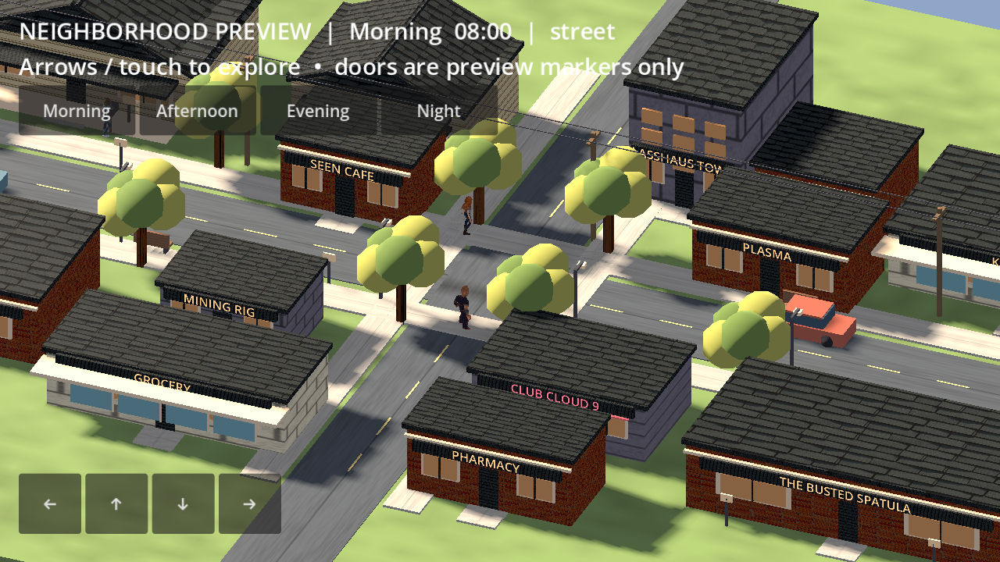
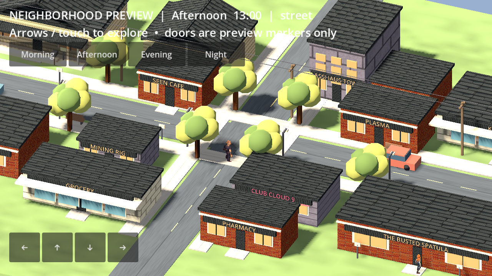
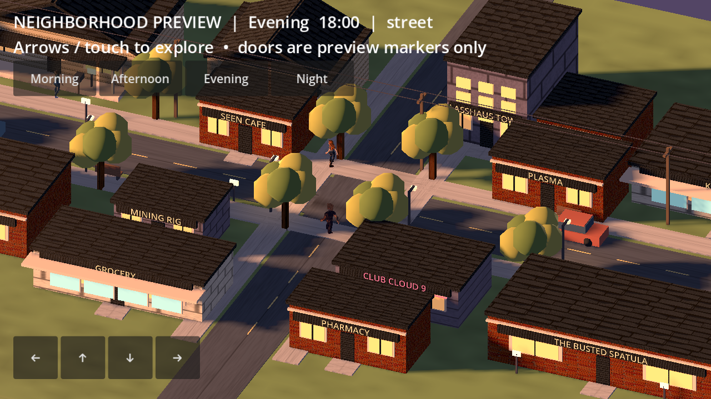
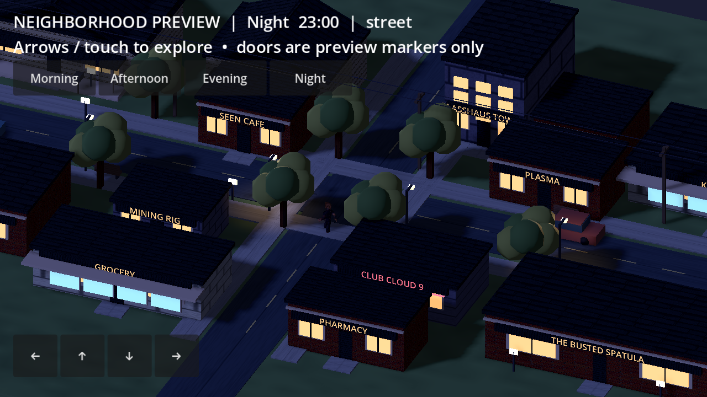

# Neighborhood foundation: actual Godot renders and performance

Draft exterior visual prototype; no production acceptance or integration. These are viewport PNGs captured by the running Godot 4.7.2 Compatibility engine, not generated concept images. Same crossroad viewpoint and clock samples for the four main comparisons. All seven at 1280×720.

| Morning 08:00 | Afternoon 13:00 |
|---|---|
|  |  |
| **Evening 18:00** | **Night 23:00** |
|  |  |

Additional views: [residential street](home-street.png), [restaurant storefront](storefronts.png), [nightlife corner](nightlife.png).

## Measured cloud performance

Godot 4.7.2 stable, OpenGL 4.5 Compatibility, Mesa 25.0.7 llvmpipe (LLVM 19.1.7, 256 bit), Xorg dummy virtual display, 1280×720, no MSAA, no supported VSync change, 12 warm-up frames, then 30 process frames per sample. Draws and primitives are engine counters at the sampled frame; FPS is 1000 / mean process-frame interval, not a GPU benchmark or sustained phone metric.

| Phase | Mean ms/frame | Approx. FPS | Draw calls | Primitives |
|---|---:|---:|---:|---:|
| Morning | 107.49 | 9.30 | 95 | 77,834 |
| Afternoon | 103.37 | 9.67 | 93 | 63,354 |
| Evening | 102.80 | 9.73 | 95 | 77,834 |
| Night | 98.11 | 10.19 | 91 | 41,406 |

The Android target remains **60 FPS / 16.67 ms**, unverified; this cloud CPU-rendered sample does not meet it, and cannot predict phone GPU performance. Need device walkthrough, touch testing, thermals and frame-time percentiles before integration. See [preview design and acceptance](../../../../spike_full3d/neighborhood/README.md).

## Verification

- Root `tools/test.sh`: 609 PASS, zero failed, `ALL PASS (0 failed)` and `TESTS PASS`, no SCRIPT ERROR; existing ObjectDB shutdown warning.
- Existing porch `smoke.gd`: 159 PASS, no FAIL or SCRIPT ERROR; shutdown warnings for leaked objects/two resources.
- Neighborhood geography smoke: 13 entrances, 8 markers, connected walkable network, bounds and building footprint blocking passed.
- Neighborhood scene smoke: three existing animated rigs, all four lighting states and simulated movement passed.
- Real renderer: all seven PNGs written and visually reviewed; no script errors. Directional buttons and light selectors visible; mobile touch gestures not tested on hardware.
- The Godot 3D import finished; sandbox editor debugger socket emitted an unrelated listen error. Runtime smoke and renderer succeeded.

Limitations: this is a modular exterior blockout with simplified foliage, sedan shapes, flat facades and visual-only marker doors; it is not final hand-authored environment art. New surfaces are procedural painterly approximations, with reused porch texture assets. NPC poses are illustrative; schedules and gameplay transitions are planned, not connected. No credits spent, new models or altered canonical gameplay state.

Reproduce (with a valid graphical display):

```sh
godot --path spike_full3d --rendering-driver opengl3 --resolution 1280x720 res://neighborhood/preview.tscn -- --capture "$PWD/docs/renders/porch3d/neighborhood"
```
